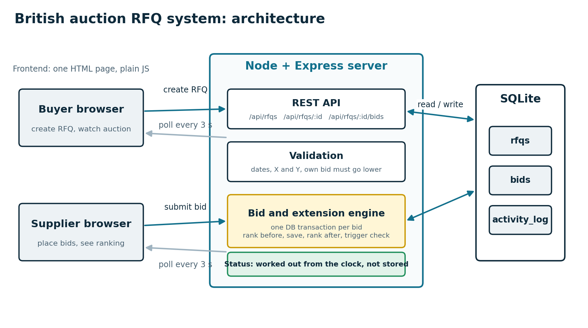
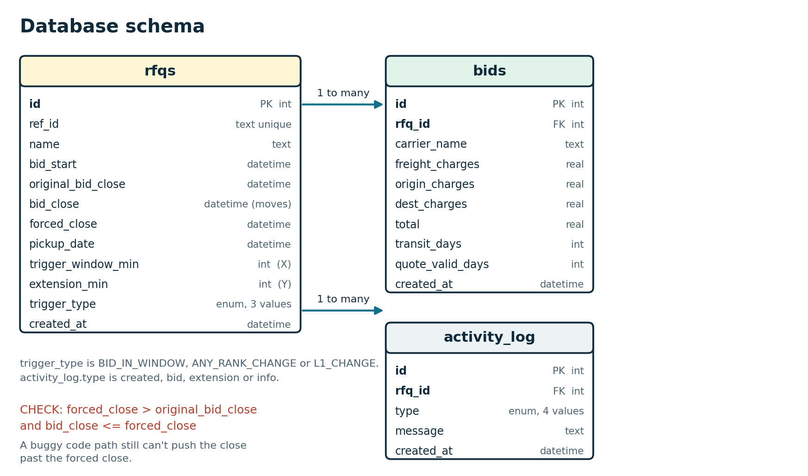

# British Auction in an RFQ System

A small RFQ (request for quotation) tool where carriers bid against each other, and the auction stretches itself if bidding gets busy near the end. It can never run past a forced close time.

A buyer posts a shipment, carriers keep lowering their price, and a late bid buys everyone more time. That stops someone from winning with a last-second bid that nobody can answer.

## What it does

- Create an RFQ with start time, close time, forced close time, pickup date and the auction rules
- Carriers submit quotes (freight, origin and destination charges, transit time, quote validity)
- Suppliers are ranked L1, L2, L3 by total price
- The close time moves automatically when the rules say so, and never past the forced close
- A listing page of all auctions, and a details page with ranking, config and an activity log
- Every extension is logged with the reason

## The auction rules

The buyer sets three things per RFQ:

| Setting | Meaning |
|---|---|
| **X** (trigger window) | How many minutes before close the system watches for activity |
| **Y** (extension) | How many minutes get added when something triggers |
| **Trigger** | What counts as activity (see below) |

| Trigger | Extends the auction when |
|---|---|
| Any bid in window | Any bid arrives in the last X minutes |
| Any rank change | The order of suppliers changes in the last X minutes |
| L1 change | A new supplier becomes the lowest bidder in the last X minutes |

**Example.** Close at 6:00 PM, X = 10, Y = 5, forced close 6:30 PM, trigger is L1 change. At 5:55 PM carrier C takes the lowest spot. That is inside the last 10 minutes, so the close moves to 6:05 PM. If this keeps happening, the close keeps moving by 5 minutes, but it stops at 6:30 PM and no later.

**Validation rules**
- Forced close must be later than bid close
- Bid close must be after bid start
- The close time can never be extended past the forced close
- A supplier's new bid must be lower than their own previous bid
- Bids are rejected before the start time and after the close

## Tech stack

- Backend: Node.js, Express
- Database: SQLite (better-sqlite3)
- Frontend: one HTML file with plain JavaScript, served by the same Express server

## Project structure

```
british-auction-rfq/
├── backend/
│   ├── server.js       API, validation, bid and extension logic
│   ├── schema.sql      table definitions
│   ├── seed.js         creates a demo auction
│   └── package.json
├── frontend/
│   └── index.html      listing, create form, details page
├── docs/
│   ├── HLD_and_Schema.pdf
│   ├── architecture.png
│   └── schema.png
└── README.md
```

## How to run

You need Node.js 18 or newer.

```bash
cd backend
npm install
npm run seed     # optional: makes a demo auction that closes in 3 minutes
npm start
```

Then open http://localhost:3000.

The database file (`auction.db`) is created automatically on first run. Delete it to start fresh.

## Try an extension yourself

1. Go to **New RFQ** and click **Fill a 3-minute demo**, then create it. (Or use the seeded one.)
2. Open the auction in two browser tabs.
3. In the first tab, bid as `Carrier A` (for example freight 100, origin 10, destination 10).
4. When the clock turns green, the watch window has started. In the second tab, bid as `Carrier B` with a lower total.
5. The close time moves, a banner appears, and the activity log shows the reason.
6. Keep underbidding to watch the close time stop at the forced close. The status then becomes Force Closed.

## Design overview



How a bid is handled:

1. The server checks that the auction is Active and the numbers are valid.
2. In one database transaction it takes the ranking, saves the bid, and takes the ranking again.
3. If the bid came within the last X minutes before close, it checks the trigger.
4. If the trigger fires, new close = the smaller of (current close + Y) and forced close. The change and the reason are written to the log.

The full write-up is in [docs/HLD_and_Schema.pdf](docs/HLD_and_Schema.pdf).

Choices worth knowing about:

- **One transaction per bid.** Two bids at the same moment can't both read an old close time and overwrite each other.
- **Status is worked out from the clock, not stored.** Upcoming, Active, Closed and Force Closed come from the current time and the close times, so there is no background job that can fall behind. Force Closed means the close was pushed all the way to the forced close and then ran out.
- **Server time only.** The browser countdown is corrected by the server's clock, so changing your own clock gains nothing.
- **Ranking uses each supplier's lowest bid.** A tie goes to whoever bid first.
- **Polling, not websockets.** The page refreshes every 3 seconds. Simpler, and enough for this.
- **The database guards the main rule too.** CHECK constraints stop the close time from passing the forced close even if the code has a bug.
- **Edge cases.** The very first bid counts as an L1 change, since there was no L1 before. A new supplier at the bottom is not a rank change, but one landing above others is. If an extension is due but the close is already at the forced close, nothing moves and the log says so.

## Database



Three tables: `rfqs`, `bids` and `activity_log`. One RFQ has many bids and many log rows. `bid_close` is the live close time and moves on extension, while `original_bid_close` keeps what the buyer first set. The SQL is in `backend/schema.sql`.

## API

| Method | Path | What it does |
|---|---|---|
| GET | /api/rfqs | Listing: name, lowest bid, current close, forced close, status |
| POST | /api/rfqs | Create an RFQ |
| GET | /api/rfqs/:id | Details: config, ranking, all bids, activity log |
| POST | /api/rfqs/:id/bids | Submit a bid (extensions happen here) |

## What was tested

The backend was tested with a script against the running server:

- Forced close earlier than or equal to bid close is rejected
- Unknown trigger type and duplicate reference ID are rejected
- An extension that would pass the forced close is capped exactly at it
- A later extension at the cap is skipped and logged
- A bid that isn't lower than the supplier's own earlier bid is rejected
- After the forced close, the status is Force Closed and new bids are rejected

The rank-change trigger was also checked by hand in the browser.

## Not included

- No login. The carrier name is typed in, and buyer and supplier aren't separate roles.
- No stats page for the success metrics (bids per RFQ, final price compared to non-extended auctions). The data for them is already in the bids table.
- Single server only. A multi-server setup would use Postgres instead of SQLite.
- No automated test suite in the repo.

## How this was built

This project was built with help from an AI assistant (Claude). [Replace this line with what you wrote or changed yourself, if anything.]